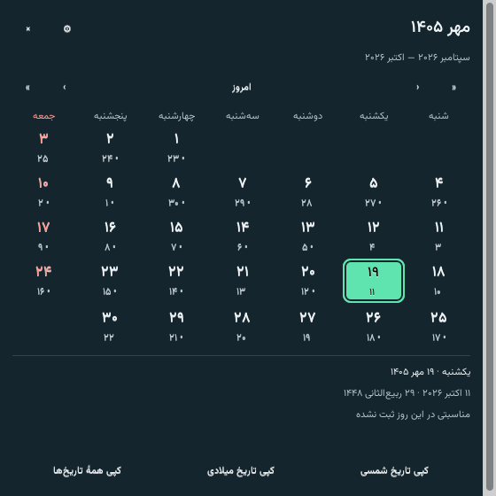
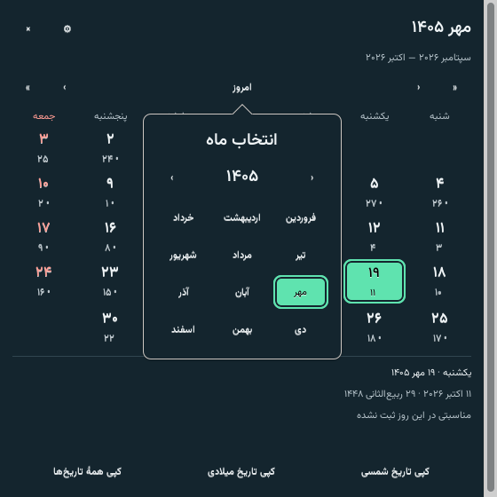
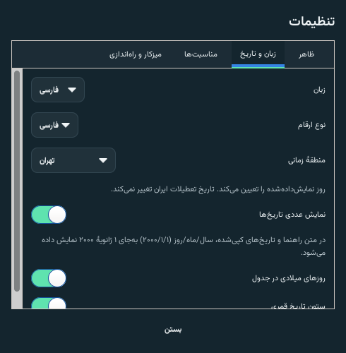

# Roozlet · روز

روز یک تقویم آفلاین و کوچک برای Linux Mint 22.3 Xfce است. کارت پیش‌فرض
۳۲۰ × ۲۰۸ پیکسل منطقی، تاریخ شمسی، میلادی و قمری رسمی ایران را نمایش می‌دهد.
با دوبار کلیک، پنجرهٔ ماهانه با مناسبت‌ها و تعطیلات باز می‌شود.

زبان فارسی و انگلیسی، انتخاب مستقل ارقام فارسی و لاتین، قلم همراه وزیرمتن،
پوستهٔ روشن و تیره، رنگ تأکید، کدری پس‌زمینه، اندازهٔ کارت و متن، انتخاب قلم،
منطقهٔ زمانی تهران یا سیستم، فیلتر مناسبت‌ها و کپی تاریخ در دسترس‌اند.
در «تنظیمات ← تاریخ‌ها»، گزینهٔ «نمایش عددی تاریخ‌ها» متن راهنما، جزئیات و
تاریخ‌های کپی‌شده را به قالب سال/ماه/روز تبدیل می‌کند. منوی «کپی تاریخ عددی»
با کلیک راست روی کارت، مستقل از این گزینه در دسترس است.
با کلیک راست روی «امروز» در تقویم، هر ۱۲ ماه و دکمه‌های تغییر سال نمایش داده
می‌شوند. کلیک معمولی همچنان به امروز برمی‌گردد؛ میان‌بر صفحه‌کلید Shift+F10 است.
اجرای هنگام ورود به‌صورت پیش‌فرض خاموش است و فقط با انتخاب شما فعال می‌شود.

تصاویر زیر از پنجره‌های واقعی GTK نسخهٔ ۰٫۱٫۱ در نمایشگر مجازی X11 گرفته شده‌اند.




## تازه در نسخهٔ ۰٫۱٫۱

سربرگ کارت فارسی در سمت راست و دکمهٔ تنظیمات در سمت چپ قرار دارد؛ در رابط
انگلیسی جای آن‌ها برعکس است. گزینهٔ تاریخ عددی و انتخاب مستقیم ماه نیز اضافه شدند.




نام پروژه در GitHub، **Roozlet** است. نسخهٔ نخست نام برنامهٔ روز، فرمان
`rooz` و نام بستهٔ Debian یعنی `rooz` را حفظ می‌کند.

## نصب، اجرا و ساخت

بسته را از [آخرین انتشار](https://github.com/saeedt20/Roozlet/releases/latest)
بارگیری کنید و فرمان زیر را در پوشهٔ فایل بارگیری‌شده اجرا کنید.

```sh
sudo apt install ./roozlet_0.1.1-1_all.deb
rooz
rooz --settings
rooz --calendar
rooz --reset-position
```

```sh
./scripts/dev-run.sh --calendar
PYTHONPATH=src python3 -m unittest discover -s tests -v
python3 scripts/validate-data.py
./scripts/test-gui.sh
./scripts/build-deb.sh
```

کلیک راست، تنظیمات و کپی تاریخ را باز می‌کند. سربرگ کارت را برای جابه‌جایی بکشید.
بستن پنجرهٔ ماهانه، کارت را نمی‌بندد. `rooz --quit` برنامه را کامل می‌بندد.
در جدول، پیکان چپ روز بعد و پیکان راست روز قبل است؛ بالا و پایین یک هفته را
جابه‌جا می‌کنند. شنبه همواره سمت راست و جمعه سمت چپ قرار دارد.

## پوشش داده

نسخهٔ 1405.1 شامل همهٔ ۳۶۵ روز سال ۱۴۰۵، ۳۰۵ رکورد مناسبت از همهٔ ۲۸۲ خانهٔ
جدول اصلی و ضمیمه، و ۲۶ تاریخ تعطیل رسمی متمایز است. منبع، تقویم نهایی مرکز
تقویم دانشگاه تهران است. روز جمعه از تعطیلات رسمی جداست. تاریخ قمری و مناسبت‌ها
بیرون از ۱۴۰۵ تأیید نشده‌اند و پیام روشن نمایش داده می‌شود. برای ۱۹۰ عنوان،
ترجمهٔ انگلیسی بررسی‌شده وجود دارد؛ ۱۱۵ رکورد دیگر عنوان فارسی را با توضیح
نبود ترجمه نشان می‌دهند. رابط برنامه کامل دوزبانه است.

تبدیل و مرور سال‌های ۱۳۵۰ تا ۱۴۵۰ آزموده شده؛ پوشش مناسبت‌ها فقط ۱۴۰۵ است.
جزئیات منابع در [DATA_SOURCES](docs/DATA_SOURCES.md) و گزارش آزمون‌ها در
[TESTING](docs/TESTING.md) قرار دارند. برنامه در زمان اجرا به اینترنت نیاز ندارد.

## حذف

```sh
rooz --quit
sudo apt remove rooz
rm -f "${XDG_CONFIG_HOME:-$HOME/.config}/autostart/rooz.desktop"
```

تنظیمات کاربر به‌صورت پیش‌فرض حفظ می‌شوند.

## مجوز

کد اصلی برنامه و مستندات با [مجوز MIT](LICENSE) منتشر می‌شوند.
حق نشر © ۲۰۲۶ سعید طاهری. قلم‌ها و کتابخانه‌های همراه مجوزهای خود را دارند؛
[اعلامیه‌های مواد شخص ثالث](THIRD_PARTY_NOTICES.md) را ببینید.
