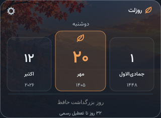
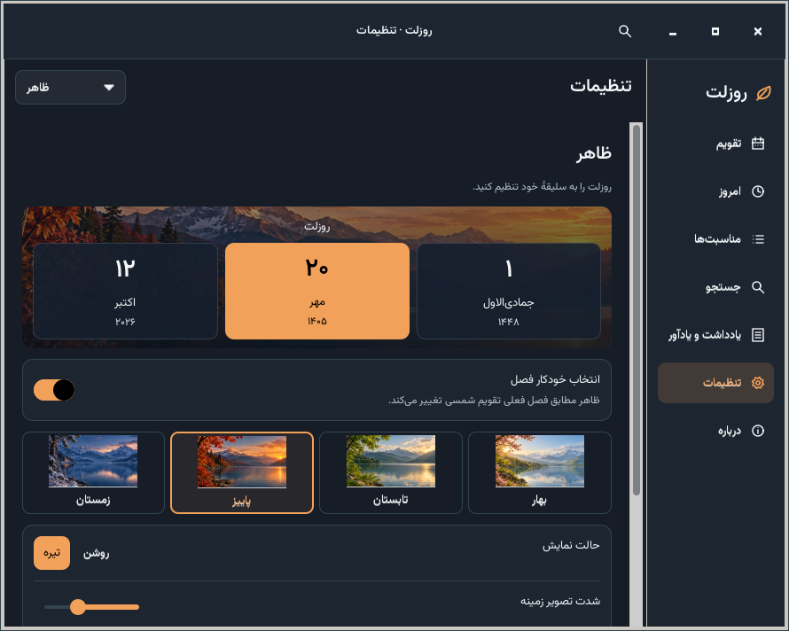
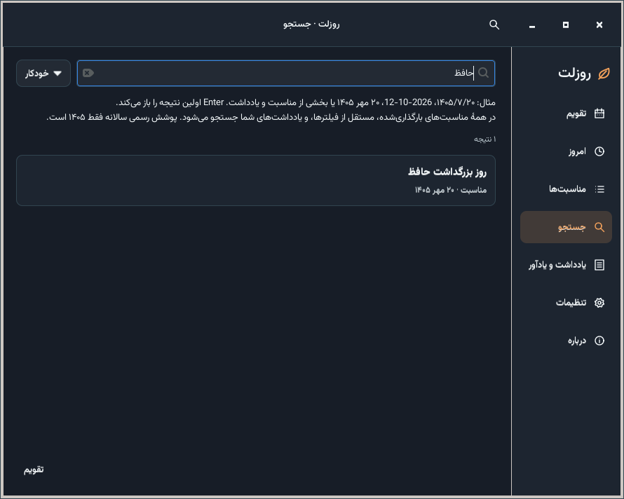
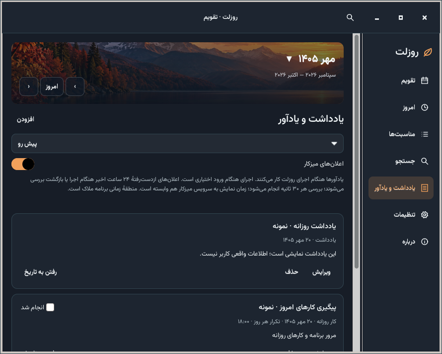
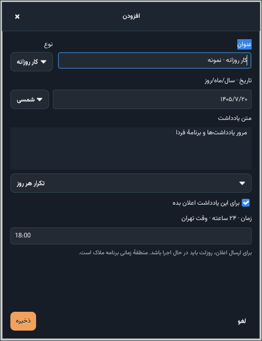
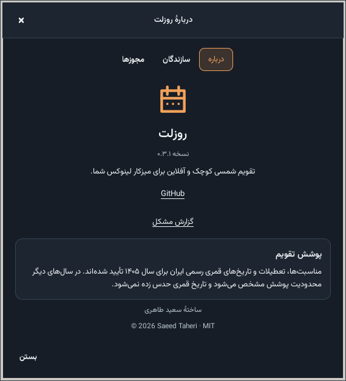

# Roozlet · روزلت

روزلت یک تقویم آفلاین و کوچک برای Linux Mint 22.3 Xfce است. کارت پیش‌فرض
۳۲۰ × ۲۳۶ پیکسل منطقی، تاریخ شمسی، میلادی و قمری رسمی ایران را نمایش می‌دهد.
با دوبار کلیک، پنجرهٔ ماهانه با مناسبت‌ها و تعطیلات باز می‌شود.

زبان فارسی و انگلیسی، انتخاب مستقل ارقام فارسی و لاتین، قلم همراه وزیرمتن،
پوستهٔ روشن و تیره، رنگ تأکید، کدری پس‌زمینه، اندازهٔ کارت و متن، انتخاب قلم،
منطقهٔ زمانی تهران یا سیستم، فیلتر مناسبت‌ها و کپی تاریخ در دسترس‌اند.
در «تنظیمات ← تاریخ‌ها»، گزینهٔ «نمایش عددی تاریخ‌ها» متن راهنما، جزئیات و
تاریخ‌های کپی‌شده را به قالب سال/ماه/روز تبدیل می‌کند. منوی «کپی تاریخ عددی»
با کلیک راست روی کارت، مستقل از این گزینه در دسترس است.
با کلیک راست روی «امروز» در تقویم، هر ۱۲ ماه و دکمه‌های تغییر سال نمایش داده
می‌شوند. کلیک معمولی همچنان به امروز برمی‌گردد؛ میان‌بر صفحه‌کلید Shift+F10 است.
اجرای هنگام ورود به‌صورت پیش‌فرض خاموش است و فقط با انتخاب شما فعال می‌شود.

## اصلاحات ۰٫۴٫۱

تنظیمات، جستجو و درباره داخل همان پنجرهٔ تقویم نمایش داده می‌شوند. کلیک دوباره پنجرهٔ تازه‌ای نمی‌سازد. متن جستجو و بخش انتخاب‌شدهٔ تنظیمات حفظ می‌شوند؛ Escape به تقویم برمی‌گردد. رابط فارسی راست‌چین و انگلیسی چپ‌چین است.

تصویر، رنگ و هر دو آیکون ویجت از فصل شمسی یکسان به‌روز می‌شوند. انتخاب دستی فصل حفظ می‌شود؛ برای نمایش فصل فعلی، «تنظیمات ← ظاهر ← انتخاب خودکار فصل» را روشن کنید. پس از نصب نسخهٔ تازه، با `rooz --quit` اجرای قبلی را ببندید و با `rooz` دوباره برنامه را اجرا کنید.




## تازه در نسخهٔ ۰٫۴٫۰

- **جستجوی سریع:** با Ctrl+F یا Ctrl+K، تاریخ شمسی/میلادی، مناسبت یا متن یادداشت را پیدا کنید. ارقام فارسی، عربی و لاتین پذیرفته می‌شوند. Enter یا کلیک روی نتیجه، همان روز و ماه را باز می‌کند.
- **یادداشت و یادآور:** یادداشت، تولد، قرار و کار روزانه اضافه کنید؛ Ctrl+N برای روز انتخاب‌شده است. ویرایش، «انجام شد» برای هر نوبت و بازگردانی حذف در دسترس‌اند.
- **تکرار:** بدون تکرار، روزانه، هفتگی یا هر سال شمسی. تولد اسفند ۳۰ در سال غیرکبیسه، آخرین روز اسفند قرار می‌گیرد.
- **اعلان اختیاری:** پیش‌فرض خاموش است. در «یادداشت و یادآور» یا تنظیمات «میزکار و راه‌اندازی» فعال کنید و برای هر یادداشت نیز اعلان را انتخاب کنید. دکمهٔ «آزمایش اعلان» سرویس میزکار را بررسی می‌کند.
- **ذخیرهٔ محلی:** اطلاعات شخصی و وضعیت ارسال در فایل SQLite با دسترسی مالک ذخیره می‌شوند و با ارتقا باقی می‌مانند. حساب ابری یا اتصال اینترنت هنگام اجرا لازم نیست.

**روزلت باید در حال اجرا باشد.** بررسی هر ۳۰ ثانیه است؛ هنگام اجرا یا بازگشت، یادآورهای ازدست‌رفتهٔ ۲۴ ساعت اخیر بررسی می‌شوند. حداکثر پنج اعلان در هر نوبت فرستاده می‌شود و خطای سرویس پس از دو دقیقه دوباره امتحان می‌شود. اجرای هنگام ورود همچنان انتخاب کاربر است. نمایش اعلان و عملکرد کلیک به سرویس میزکار وابسته‌اند؛ کلیک اعلان وقتی روزلت اجراست، روز مربوط را باز می‌کند.

جستجو همهٔ مناسبت‌های بارگذاری‌شده را مستقل از فیلتر بررسی می‌کند. پوشش رسمی مناسبت‌ها و قمری همچنان فقط ۱۴۰۵ است؛ یادداشت‌های شخصی و رفتن به تاریخ در محدودهٔ شمسی ۱۳۵۰ تا ۱۴۵۰ کار می‌کنند. علامت ◇ برای اطلاعات شخصی است و تعطیل رسمی محسوب نمی‌شود.

تصاویر زیر از اجرای واقعی GTK با **اطلاعات نمایشی ساختگی** هستند:





جزئیات تکرار، اعلان و نسخهٔ پشتیبان در [PERSONAL](docs/PERSONAL.md) آمده است.

## اصلاحات ۰٫۳٫۱

- پنجرهٔ «درباره» با سه بخش معرفی، سازندگان و مجوزها بازطراحی شده است.
- متن بلند منابع چندخطی و اسکرول‌پذیر است و پنجره را از کادر صفحه خارج نمی‌کند.
- لینک **GitHub** و «گزارش مشکل» مشخص‌اند؛ متن اصلی مجوزها آفلاین در دسترس است.
- عنوان، دکمه‌ها و جهت نوشتار با زبان خود برنامه هماهنگ‌اند.




## تازه در نسخهٔ ۰٫۳٫۰

چهار ظاهر **بهار، تابستان، پاییز و زمستان** با تصاویر همراه برنامه اضافه شده‌اند.
تاریخ **شمسی همیشه وسط ویجت** است؛ میلادی سمت چپ و قمری سمت راست قرار دارند.
مخفی‌کردن تاریخ‌های کناری هم جای شمسی را تغییر نمی‌دهد.

ظاهر می‌تواند خودکار براساس فصل شمسی فعلی یا دستی باشد. حالت روشن و تیره، رنگ
دلخواه، شدت تصویر و ظاهر ساده مستقل‌اند. گزینهٔ «ظاهر مطابق ماه نمایش‌داده‌شده»
فقط ظاهر تقویم کامل را تغییر می‌دهد؛ ویجت روی فصل امروز باقی می‌ماند.

با کلیک روی عنوان ماه، هر ۱۲ ماه و کنترل سال باز می‌شوند. راست‌کلیک روی «امروز»
و Shift+F10 نیز حفظ شده‌اند. نوار کناری فارسی در راست و انگلیسی در چپ است.
فهرست مناسبت‌های ماه امکان انتخاب مستقیم روز را دارد.

**پس از ارتقا:** برای حفظ ظاهر قبلی، تنظیمات قدیمی با حالت ساده باز می‌شوند.
برای فعال‌کردن فصل‌ها از «تنظیمات ← ظاهر ← تنظیمات پیشرفته ← سبک ظاهر ← فصلی» استفاده کنید.
نصب تازه با ظاهر فصلی خودکار شروع می‌شود. تصویر دسکتاپ یا تنظیمات سیستم تغییر نمی‌کنند.

تصاویر زیر از اجرای واقعی GTK نسخهٔ ۰٫۳٫۰ در نمایشگر مجازی X11 هستند.


نام قابل‌نمایش برنامه **روزلت / Roozlet** است. فرمان و نام بستهٔ Debian همچنان
`rooz` هستند تا نصب‌های قبلی به‌درستی ارتقا پیدا کنند.

## تازه در ۰٫۳٫۰

- هدر منظره در تقویم، جدول سبک‌تر و کارت جزئیات روز با منوی «کپی تاریخ».
- تنظیمات گروه‌بندی‌شده با نوار کناری فارسی راست و انگلیسی چپ، پیش‌نمایش زندهٔ ویجت و بخش پیشرفته.
- متن و آیکون دکمه‌های منو مطابق جهت زبان؛ جدول انگلیسی نیز از چپ به راست است.
- گذارهای کوتاه ۱۶۰ تا ۱۸۰ میلی‌ثانیه و تغییر ملایم تصویر فصل در ۲۶۰ میلی‌ثانیه.
  گزینهٔ «حرکت‌های ملایم» در ظاهر، گذارهای برنامه را خاموش می‌کند و تنظیم حرکت GTK سیستم نیز رعایت می‌شود.
- بدون جلوهٔ تکرارشونده یا حرکت هنگام بیکاری؛ تاریخ شمسی همچنان مرکز ویجت است.
- تنظیمات قبلی، وزیرمتن، ارقام مستقل، فیلترها، دادهٔ معتبر و انتخاب اجرای هنگام ورود حفظ می‌شوند.


## نصب، اجرا و ساخت

بسته را از [آخرین انتشار](https://github.com/saeedt20/Roozlet/releases/latest)
بارگیری کنید و فرمان زیر را در پوشهٔ فایل بارگیری‌شده اجرا کنید.

```sh
install -m 644 ./roozlet_0.4.1-1_all.deb /tmp/roozlet_0.4.1-1_all.deb
rooz --quit
sudo apt install /tmp/roozlet_0.4.1-1_all.deb
rooz
rooz --settings
rooz --calendar
rooz --search
rooz --personal
rooz --reset-position
```

```sh
./scripts/dev-run.sh --calendar
PYTHONPATH=src python3 -m unittest discover -s tests -v
python3 scripts/validate-data.py
./scripts/test-gui.sh
./scripts/build-deb.sh
```

کلیک راست، تنظیمات و کپی تاریخ را باز می‌کند. سربرگ کارت را برای جابه‌جایی بکشید.
بستن پنجرهٔ ماهانه، کارت را نمی‌بندد. `rooz --quit` برنامه را کامل می‌بندد.
در جدول فارسی، شنبه راست و جمعه چپ است؛ پیکان چپ روز بعد را انتخاب می‌کند.
در رابط انگلیسی، شنبه چپ و جمعه راست است و پیکان راست روز بعد را انتخاب می‌کند.
بالا و پایین در هر دو زبان یک هفته جابه‌جا می‌کنند.

کپی خواندنی در `/tmp` از پیام دسترسی `_apt` در پوشهٔ خصوصی خانه جلوگیری می‌کند.

نسخهٔ ۰٫۴٫۰ در مجموع **۸۳ تست** را گذرانده است: ۴۷ تست منطق و داده، ۳۰ تست GTK و شش تست پروتکل اعلان. مجموعهٔ کامل در مقیاس ۲۰۰٪ هم موفق بود.

## پوشش داده

نسخهٔ 1405.1 شامل همهٔ ۳۶۵ روز سال ۱۴۰۵، ۳۰۵ رکورد مناسبت از همهٔ ۲۸۲ خانهٔ
جدول اصلی و ضمیمه، و ۲۶ تاریخ تعطیل رسمی متمایز است. منبع، تقویم نهایی مرکز
تقویم دانشگاه تهران است. روز جمعه از تعطیلات رسمی جداست. تاریخ قمری و مناسبت‌ها
بیرون از ۱۴۰۵ تأیید نشده‌اند و پیام روشن نمایش داده می‌شود. برای ۱۹۰ عنوان،
ترجمهٔ انگلیسی بررسی‌شده وجود دارد؛ ۱۱۵ رکورد دیگر عنوان فارسی را با توضیح
نبود ترجمه نشان می‌دهند. رابط برنامه کامل دوزبانه است.

تبدیل و مرور سال‌های ۱۳۵۰ تا ۱۴۵۰ آزموده شده؛ پوشش مناسبت‌ها فقط ۱۴۰۵ است.
جزئیات منابع در [DATA_SOURCES](docs/DATA_SOURCES.md) و گزارش آزمون‌ها در
[TESTING](docs/TESTING.md) قرار دارند. برنامه در زمان اجرا به اینترنت نیاز ندارد.

## حذف

```sh
rooz --quit
sudo apt remove rooz
rm -f "${XDG_CONFIG_HOME:-$HOME/.config}/autostart/rooz.desktop"
```

تنظیمات کاربر به‌صورت پیش‌فرض حفظ می‌شوند.

## مجوز

کد اصلی برنامه و مستندات با [مجوز MIT](LICENSE) منتشر می‌شوند.
حق نشر © ۲۰۲۶ سعید طاهری. قلم‌ها و کتابخانه‌های همراه مجوزهای خود را دارند؛
[اعلامیه‌های مواد شخص ثالث](THIRD_PARTY_NOTICES.md) را ببینید.
