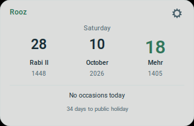
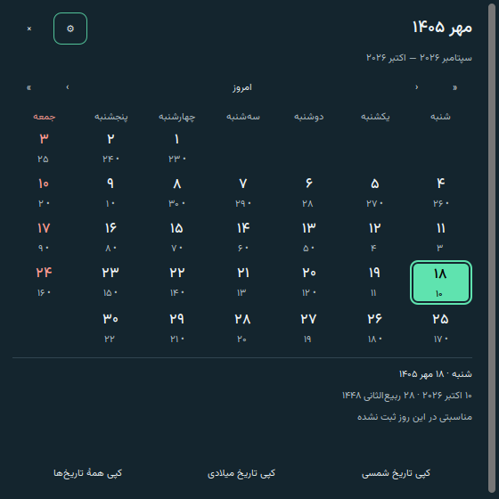
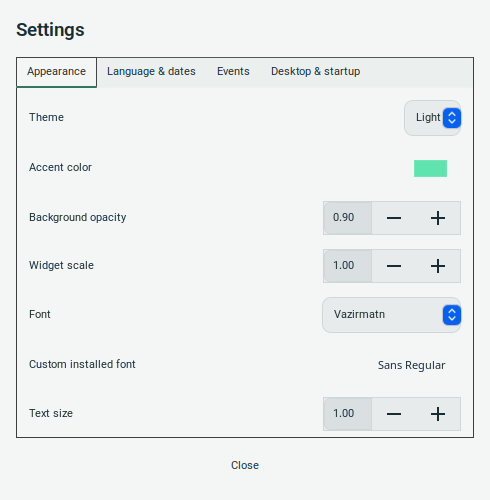
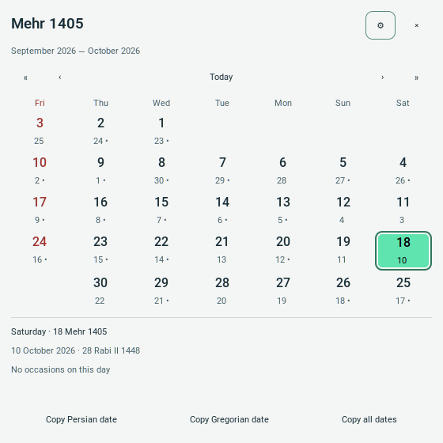
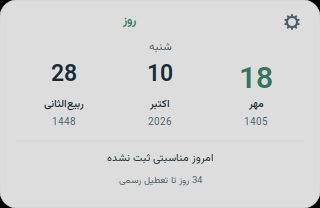
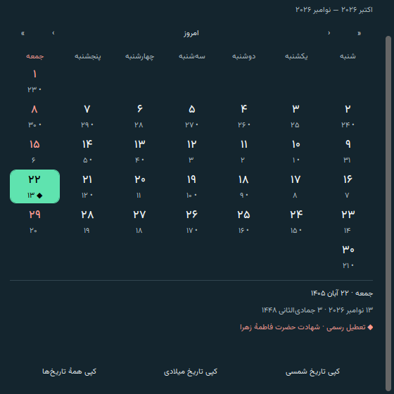
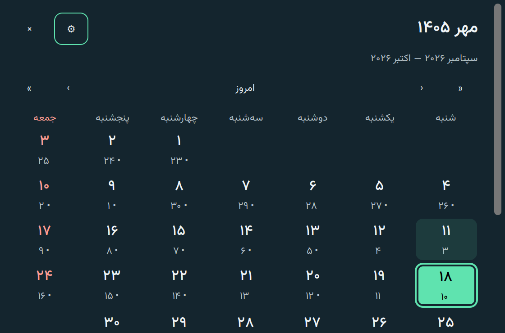
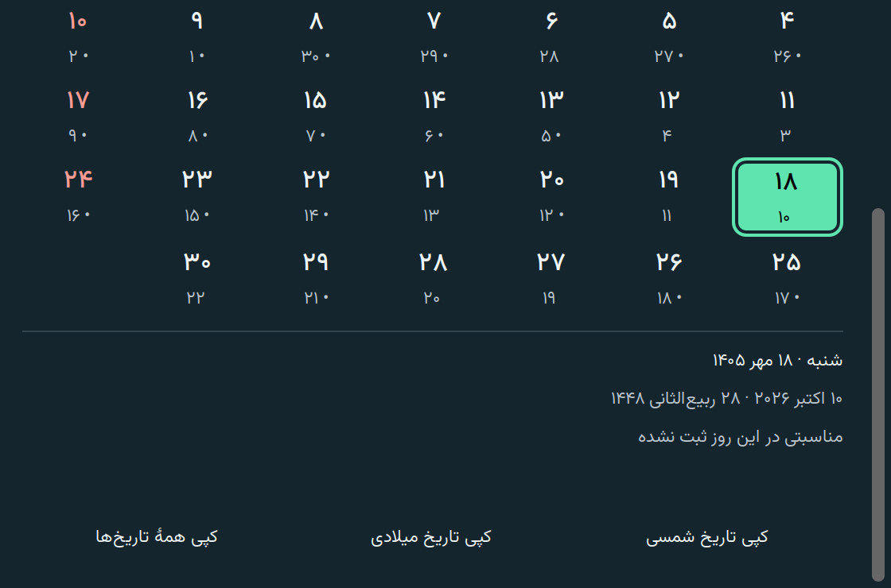

<p align="center">
  
</p>

<h1 align="center">Roozlet</h1>
<p align="center">A little Persian calendar for your Linux desktop.</p>
<p align="center">
  <a href="https://github.com/saeedt20/Roozlet/releases/latest"></a>
  <a href="https://github.com/saeedt20/Roozlet/actions/workflows/ci.yml"></a>
  <a href="LICENSE"></a>
  
</p>
<p align="center">
  <a href="https://github.com/saeedt20/Roozlet/releases/latest">Download</a> ·
  <a href="README.fa.md">فارسی</a> ·
  <a href="docs/DATA_SOURCES.md">Calendar data</a> ·
  <a href="https://github.com/saeedt20/Roozlet/issues">Report an issue</a>
</p>

Roozlet keeps today's Persian, Gregorian and official Iranian Hijri dates on a
compact desktop card. Double-click it to open a full month calendar with Iranian
occasions and public holidays. Built with native GTK3 for **Linux Mint 22.3 Xfce**,
it works offline and stays out of the way.

The first release retains the application name **Rooz / روز**, the `rooz` command,
and the Debian package name `rooz`. The GitHub project is **Roozlet**.

## See it in action

These are actual application captures on Mint Xfce, not concept mockups.
The default card measures **320 × 208 logical pixels**.

<table>
  <tr><th>Persian · dark</th><th>English · light</th></tr>
  <tr>
    <td></td>
    <td></td>
  </tr>
  <tr><th>Month calendar</th><th>Appearance settings</th></tr>
  <tr>
    <td></td>
    <td></td>
  </tr>
</table>

<details>
<summary>More examples: English calendar, independent digits, holiday details and 200% scaling</summary>



Persian interface with independently selected Latin digits:



Selected official holiday and its details:



Full calendar at 200% scale on a constrained work area; scroll to reach the lower controls:





</details>

## Features

- **Compact desktop widget:** three dates, an occasion summary and the next public-holiday countdown.
- **Full calendar:** computed Persian month grids, Gregorian secondary dates, distinct holiday/event markers, selected-day details and copy actions.
- **Bilingual controls:** complete Persian and English interfaces, independent Persian/Latin digits and bundled Vazirmatn fonts.
- **Personal appearance:** dark/light themes, accent color, background opacity, font choice, card size and text scale.
- **Desktop behavior:** header dragging, position lock/reset, optional always-on-top and all-workspaces placement, and single-instance operation.
- **Your startup choice:** start at login is off by default and controlled in Settings.
- **Offline operation:** no account, telemetry, runtime downloads or calendar API dependency.

## Install

Download `rooz_0.1.0-1_all.deb` from the [latest release](https://github.com/saeedt20/Roozlet/releases/latest).
From the folder containing the downloaded file:

```bash
sudo apt install ./rooz_0.1.0-1_all.deb
rooz
```

APT resolves the native GTK, Cairo, Fontconfig and timezone dependencies.
Installation adds a desktop launcher; it does not start the app or enable login startup.
Run the app as your ordinary user.

Optional: download all three release assets into the same folder and verify them:

```bash
sha256sum -c SHA256SUMS
```

### Everyday use

Double-click the card to open the month view. Use the gear for Settings, right-click
for calendar/copy/position actions, and drag the header to move the unlocked card.
Closing the calendar or Settings leaves the card running.

| Command | Action |
| --- | --- |
| `rooz` | Start the card; a repeat invocation raises the calendar |
| `rooz --widget` | Start or retain card mode, without opening the month view |
| `rooz --calendar` | Open or raise the month view |
| `rooz --settings` | Open or raise Settings |
| `rooz --reset-position` | Restore a safe default card position |
| `rooz --check-data` | Report installed calendar coverage and validation |
| `rooz --version` | Print the version |
| `rooz --quit` | Close the running application |

In the month grid, **Saturday is on the right** and **Friday is on the left** in
both languages. Left moves one day forward; Right moves one day backward.
Up/Down move one week, Page Up/Down move one month, and Home/End select the first/last
day of the month. The Today button returns to the current civil day.

Start at login uses your XDG autostart entry. Enable or disable it in Settings
under Desktop & startup. The development checkout cannot enable it until
`/usr/bin/rooz` is installed.

## Calendar accuracy and coverage

Dates come from tested conversion logic, not from screenshot layouts.
The default civil timezone is **Asia/Tehran**; the system timezone is also selectable.

| Data | Verified coverage |
| --- | --- |
| Persian/Gregorian browsing and conversion | 1350–1450; all 36,890 days round-trip tested |
| Independent official annual date mappings | Every day of 1405: 2026-03-21 through 2027-03-20 |
| Official Iranian Hijri dates | 1405 only; derived from the final Iranian annual calendar |
| Iranian occasions | 305 records from all 189 main and 93 appendix occasion cells for 1405 |
| Statutory public holidays | 26 distinct dates in 1405; ordinary Fridays are separate |

The bundled dataset is **1405.1**, sourced from the final University of Tehran
Calendar Center calendar. Leap flags across the conversion range are checked
against the Center's independent leap-year reference.

Outside 1405, the app states that annual occasion coverage is incomplete and
Hijri dates are unavailable. Future lunar holidays are not guessed. Of the occasion
records, 190 have reviewed English translations; 115 display their Persian title
with an explicit translation-fallback notice.

See [data provenance, checksums and update procedure](docs/DATA_SOURCES.md).

## Build from source

```bash
git clone https://github.com/saeedt20/Roozlet.git
cd Roozlet
sudo apt install python3 python3-gi python3-cairo python3-gi-cairo gir1.2-gtk-3.0 tzdata libfontconfig1
./scripts/dev-run.sh --calendar
```

Build the Debian package and publication source archive:

```bash
./scripts/build-deb.sh
python3 scripts/source-archive.py
(cd dist && sha256sum -c SHA256SUMS)
```

Output is in `dist/`. The rootless build uses `dpkg-deb`, needs no pip or runtime
network downloads, and bundles pinned conversion-library source and static fonts
with their licenses. Native libraries remain declared system dependencies.
Standard debhelper packaging is also available; see [release instructions](docs/RELEASING.md).

### Tests

```bash
PYTHONPATH=src python3 -m unittest discover -s tests -v
python3 scripts/validate-data.py
./scripts/test-gui.sh
GDK_SCALE=2 ./scripts/test-gui.sh
```

The GTK checks need an active display or Xvfb. They use temporary XDG directories
and a private D-Bus session. Recorded validation includes **20 core tests**, **seven
GTK checks at each scale**, **21 native Xfce interaction checks**, installed-layout
launches, Persian clipboard round trips and reproducible package builds.

See the [full validation record](docs/TESTING.md), including checks still requiring
real login, suspend, physical monitor changes and package-manager lifecycle testing.
X11 is the release target; Wayland has not been validated.

## Remove

```bash
rooz --quit
sudo apt remove rooz
```

User preferences are preserved. If you enabled login startup, disable it before
removal or remove only its entry afterwards:

```bash
rm -f "${XDG_CONFIG_HOME:-$HOME/.config}/autostart/rooz.desktop"
```

## Contributing

Bug reports and focused pull requests are welcome. Include your desktop session,
app version, relevant settings and steps to reproduce. Calendar-data corrections
must cite an authoritative source and include a regression check. Keep the default
card compact, preserve independent language/digit settings, and avoid runtime
network dependencies. See [design notes](docs/DESIGN.md) and [development instructions](AGENTS.md).

## License and acknowledgments

Original application code and documentation are licensed under the **[MIT license](LICENSE)**,
copyright © 2026 Saeed Taheri.

Bundled jdatetime, jalali-core and Vazirmatn retain their own licenses. Calendar
facts are attributed to the University of Tehran Calendar Center; the original
annual PDF is not redistributed. See [third-party notices](THIRD_PARTY_NOTICES.md).

Roozlet is an independent project, not an official Linux Mint product.
