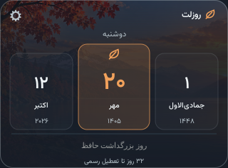
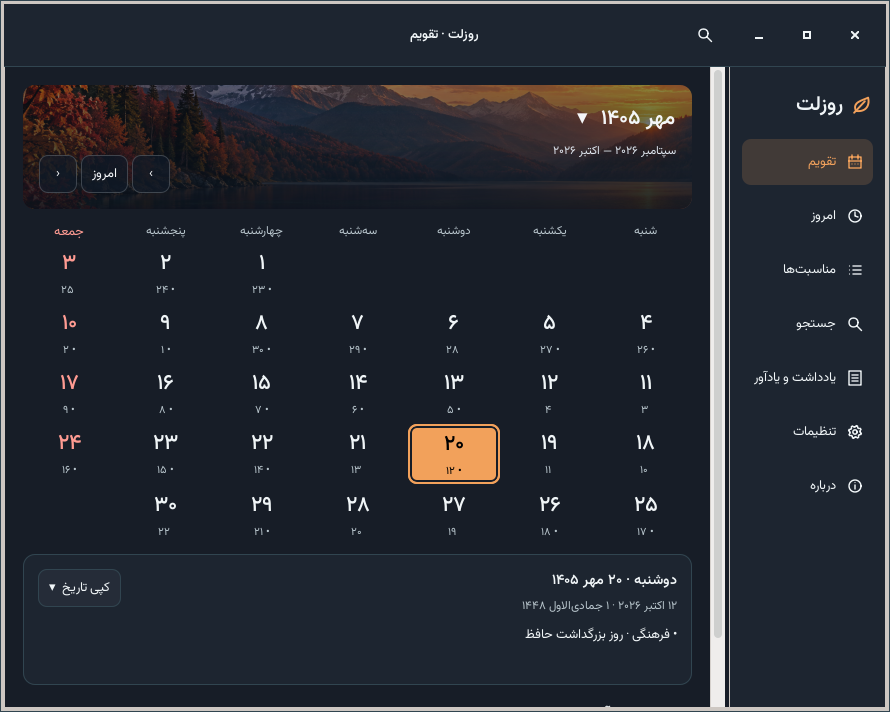
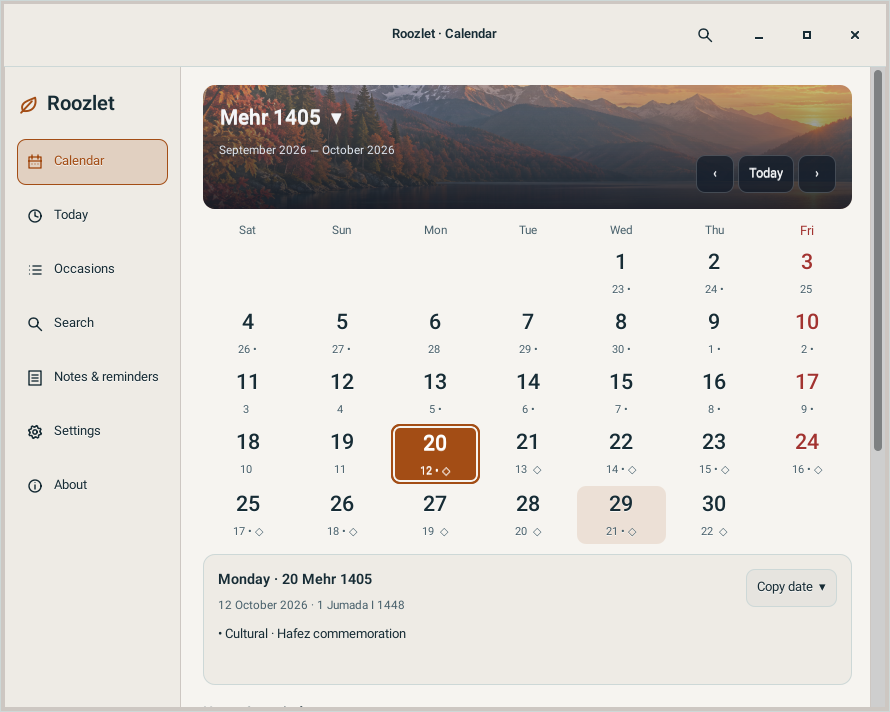
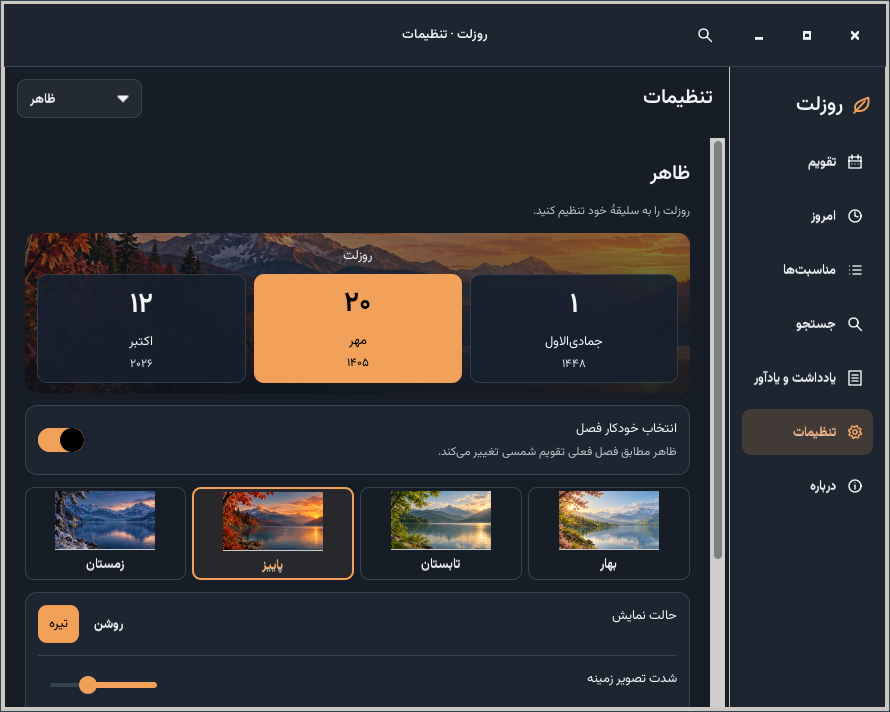
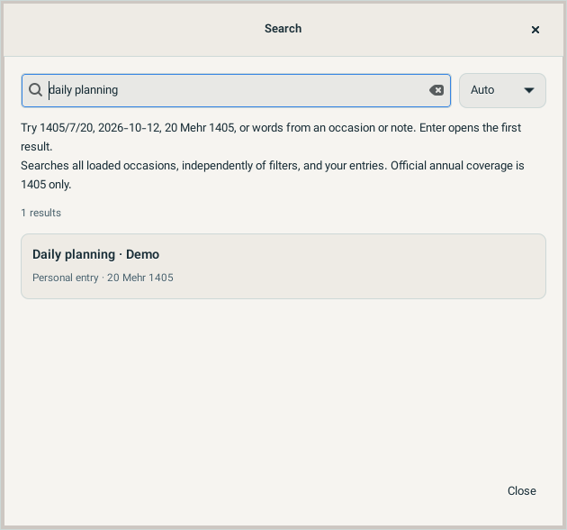
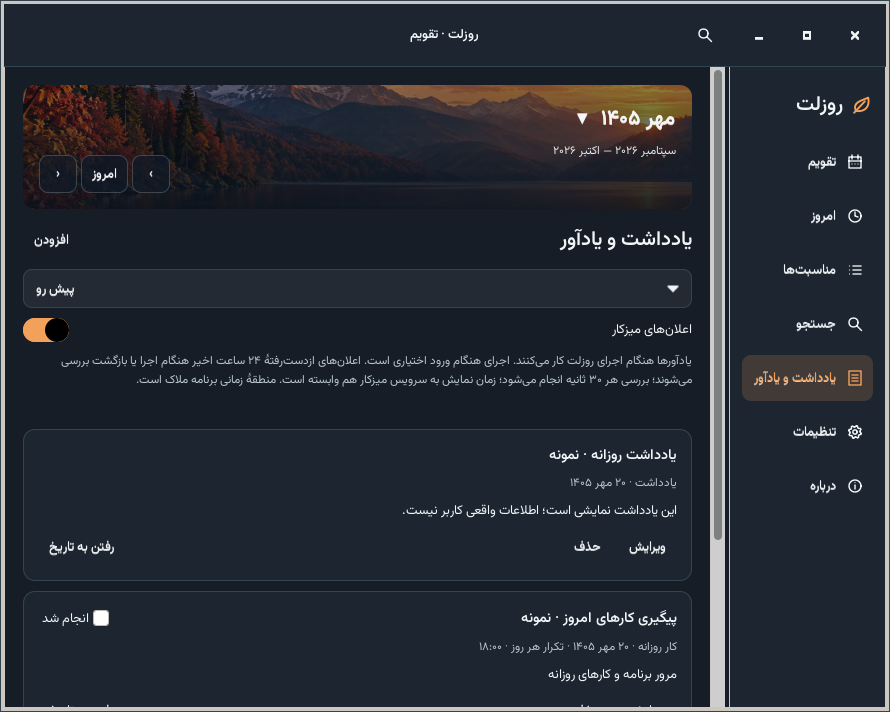
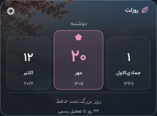

<p align="center">
  
</p>

<h1 align="center">Roozlet · روزلت</h1>

<p align="center">
  <strong>A compact, offline-first Persian (Shamsi) calendar widget and month planner for Linux Xfce.</strong>
</p>

<p align="center">
  <a href="https://github.com/saeedt20/Roozlet/releases/latest">
    
  </a>
  <a href="https://github.com/saeedt20/Roozlet/actions/workflows/ci.yml">
    
  </a>
  
  
  
  <a href="LICENSE">
    
  </a>
</p>

<p align="center">
  <a href="https://github.com/saeedt20/Roozlet/releases/latest">Download (.deb)</a> ·
  <a href="#screenshots">Screenshots</a> ·
  <a href="#features">Features</a> ·
  <a href="#installation">Install</a> ·
  <a href="#cli--shortcuts">CLI &amp; Shortcuts</a> ·
  <a href="README.fa.md">فارسی</a> ·
  <a href="https://github.com/saeedt20/Roozlet/issues">Report an Issue</a>
</p>

---

**Roozlet** keeps **Persian (Solar Hijri)**, **Gregorian**, and **verified Iranian Hijri** dates together on a lightweight desktop card (`320 × 236` logical px). Double-click the card to open a full month calendar with Iranian occasions, statutory public holidays, instant offline search, private notes, and optional desktop reminders.

Built natively with **Python 3 + GTK 3** for **Linux Mint 22.3 (Xfce / X11)**, Roozlet works completely offline with bundled **Vazirmatn** fonts and zero accounts, telemetry, or runtime network calls.

> [!NOTE]
> The visible branding is **Roozlet / روزلت**, while the CLI command and Debian package name remain **`rooz`** so existing installations upgrade cleanly. Roozlet targets **Xfce on X11**; Wayland has not been validated.

## Screenshots

<table>
  <tr>
    <th width="38%">Seasonal Desktop Card (Persian Dark)</th>
    <th width="62%">Month Calendar View (Persian Dark)</th>
  </tr>
  <tr>
    <td align="center">
      
    </td>
    <td align="center">
      
    </td>
  </tr>
</table>

<details>
  <summary>More screenshots: English light mode, unified Settings, Search, Notes &amp; Spring theme</summary>
  <br>
  <table>
    <tr>
      <th>Month Calendar (English Light)</th>
      <th>Unified Settings Pane</th>
    </tr>
    <tr>
      <td align="center">
        
      </td>
      <td align="center">
        
      </td>
    </tr>
    <tr>
      <th>Instant Offline Search</th>
      <th>Personal Notes &amp; Reminders</th>
    </tr>
    <tr>
      <td align="center">
        
      </td>
      <td align="center">
        
      </td>
    </tr>
    <tr>
      <th colspan="2">Spring Card Theme</th>
    </tr>
    <tr>
      <td colspan="2" align="center">
        
      </td>
    </tr>
  </table>
</details>

*All screenshots are native GTK 3 captures from an isolated X11 session. Personal entries shown are synthetic demo records.*

## Features

- **Tri-Calendar Desktop Card**
  - Centered **Shamsi** primary date alongside toggleable **Gregorian** and **Iranian Hijri** columns.
  - Displays the weekday, today's top occasions, and a next public-holiday countdown.
  - Supports human-readable and numerical (`YYYY/MM/DD`) date copying directly from the context menu.
- **Full Month Calendar & Occasions**
  - Compact 5/6-row grid with separate visual/accessible states for **Today**, **Selected day**, **Fridays**, **Personal markers (`◇`)**, and **Statutory public holidays**.
  - Quick **12-month & year picker** (click the month header, right-click **Today**, or press `Shift+F10`).
  - Category filters for *National/Cultural*, *Religious*, *International*, and *Public Holidays*.
- **Offline Search, Notes & Reminders**
  - Search Shamsi/Gregorian dates (numerical or named, normalizing Persian/Arabic/Latin digits), official occasions, and personal entries.
  - Add **Notes**, **Birthdays**, **Appointments**, and **Tasks** with one-time, daily, weekly, or Shamsi-yearly recurrence (handles *Esfand 30* in non-leap years), per-occurrence completion, and reversible deletion (**Undo**).
  - **Opt-in desktop notifications** (off by default): 30-second background checks, 24-hour missed-alert catch-up on startup/resume, and DST-aware scheduling while Roozlet is running.
- **Seasonal Artwork, Themes & Typography**
  - Four bundled seasonal landscapes (**Spring, Summer, Autumn, Winter**) with automatic Shamsi-season switching or manual choice, plus **Classic** mode, **Light/Dark** themes, custom accent color, background opacity, and independent widget/text scaling.
  - Complete **Persian (RTL)** and **English (LTR)** UI with independent **Persian (`۰–۹`) / Latin (`0–9`)** digit preferences and bundled **Vazirmatn** fonts.
- **Native Xfce Integration & Privacy**
  - Single-instance `Gtk.Application` shell where Calendar, Search, Settings, Notes, and About live inside one reusable window.
  - Draggable header, position lock/reset, multi-monitor coordinate clamping, optional always-on-top and all-workspaces placement, and opt-in XDG login autostart.
  - Zero network calls, zero telemetry; personal entries are stored in an owner-only (`0600`) local SQLite database.

## Installation

### Install on Linux Mint / Ubuntu / Debian

Download **[`roozlet_0.4.2-1_all.deb`](https://github.com/saeedt20/Roozlet/releases/download/v0.4.2/roozlet_0.4.2-1_all.deb)** from the [latest release](https://github.com/saeedt20/Roozlet/releases/latest), then run in your download directory:

```sh
install -m 644 ./roozlet_0.4.2-1_all.deb /tmp/roozlet_0.4.2-1_all.deb
sudo apt install /tmp/roozlet_0.4.2-1_all.deb
rooz
```

> [!TIP]
> Copying the `.deb` to `/tmp` with `644` permissions prevents `_apt` permission warnings when installing from a private home folder. Installation does **not** auto-launch Roozlet or enable login startup.

### Verify Release Checksums

To verify package integrity, download `roozlet_0.4.2-1_all.deb`, the source tarball, and `SHA256SUMS` from the [v0.4.2 release](https://github.com/saeedt20/Roozlet/releases/tag/v0.4.2) into one directory and run:

```sh
sha256sum -c SHA256SUMS
```

### Upgrading

Stop the running instance before installing a new `.deb`, then restart afterward (package installation does not reload an active process):

```sh
rooz --quit
install -m 644 ./roozlet_0.4.2-1_all.deb /tmp/roozlet_0.4.2-1_all.deb
sudo apt install /tmp/roozlet_0.4.2-1_all.deb
rooz
```

All preferences, personal notes, and reminder history are preserved across upgrades.

### Uninstalling

```sh
rooz --quit
sudo apt remove rooz
```

User preferences and personal entries are preserved by default. To also remove login autostart and local user data:

```sh
rm -f "${XDG_CONFIG_HOME:-$HOME/.config}/autostart/rooz.desktop"
rm -rf "${XDG_CONFIG_HOME:-$HOME/.config}/rooz" "${XDG_DATA_HOME:-$HOME/.local/share}/rooz"
```

## CLI & Shortcuts

### Everyday Commands

| Command | Action |
|---|---|
| `rooz` | Start the desktop card (or raise the calendar if already running) |
| `rooz --widget` | Start/ensure compact card mode only (used by login autostart) |
| `rooz --calendar` | Open or raise the full month calendar |
| `rooz --search` | Open Search for dates, occasions, and personal entries |
| `rooz --personal` | Open Notes & reminders |
| `rooz --settings` | Open Settings inside the calendar shell |
| `rooz --reset-position` | Restore the card to the primary monitor's upper-right work area |
| `rooz --quit` | Gracefully exit the running instance |
| `rooz --check-data` | Validate bundled/user calendar datasets and print JSON status (headless) |
| `rooz --version` | Print the installed version and exit (headless) |

### Mouse & Keyboard Navigation

| Action / Shortcut | Behavior |
|---|---|
| **Double-click card** | Open or raise the full month calendar |
| **Drag card header** | Reposition the card on the desktop (when unlocked) |
| **Right-click card** | Open context menu (Calendar, Search, Settings, Copy date, Lock, Always on top, Reset, Quit) |
| `Ctrl+F` / `Ctrl+K` | Open Search inside the calendar |
| `Ctrl+N` | Create a new personal entry for the selected day |
| `←` `→` `↑` `↓` | Move day selection (direction-aware for Persian RTL & English LTR) |
| `PageUp` / `PageDown` | Navigate to the previous / next month |
| `Home` / `End` | Jump to the first / last day of the displayed month |
| `Shift+F10` *(or right-click Today)* | Open the 12-month & year picker |
| `Esc` | Return to Calendar from sub-views, or close the window (keeps card running) |

## Calendar Coverage & Data Provenance

Roozlet separates browsing range, Iranian lunar mapping, and annual occasion data so unsupported years never display guessed holidays:

| Dataset / Capability | Verified Coverage |
|---|---|
| Persian / Gregorian conversion & browsing | Shamsi **1350–1450** |
| Official Iranian Hijri date mapping | **1405 only** |
| Official Iranian occasions & statutory holidays | **1405 only** — 365 days, 305 occasion records, 26 distinct public-holiday dates |

- **Authoritative source:** The bundled `1405.1` dataset is derived from the University of Tehran Calendar Center's final 1405 calendar.
- **Honest fallback:** Outside `1405`, annual coverage is explicitly marked incomplete and Iranian Hijri dates are reported as unavailable—future lunar holidays are never extrapolated. Some English occasion titles retain an explicit Persian fallback rather than fabricated translations.
- **Timezone:** Uses **`Asia/Tehran`** by default (with a System timezone option in Settings) and keeps personal entries separate from official public holidays.

See [`docs/DATA_SOURCES.md`](docs/DATA_SOURCES.md) for verification methodology, checksums, and annual update instructions.

## Local Storage

| Purpose | Path |
|---|---|
| Preferences | `${XDG_CONFIG_HOME:-~/.config}/rooz/config.json` |
| Personal notes & reminders | `${XDG_DATA_HOME:-~/.local/share}/rooz/personal.sqlite3` *(mode `0600`)* |
| Optional custom annual JSONs | `${XDG_DATA_HOME:-~/.local/share}/rooz/calendars/` |
| Opt-in login autostart | `${XDG_CONFIG_HOME:-~/.config}/autostart/rooz.desktop` |

## Build from Source

### 1. Install Dependencies

```sh
git clone https://github.com/saeedt20/Roozlet.git
cd Roozlet
sudo apt install git python3 python3-gi python3-cairo python3-gi-cairo gir1.2-gtk-3.0 tzdata libfontconfig1
```

### 2. Run, Test & Validate

```sh
# Launch from the checkout
./scripts/dev-run.sh --calendar

# Run unit & logic tests
PYTHONPATH=src python3 -m unittest discover -s tests -v

# Validate bundled calendar datasets
python3 scripts/validate-data.py

# Run native GTK smoke tests (requires a graphical display or xvfb-run)
./scripts/test-gui.sh
```

### 3. Build a Reproducible `.deb` Package

```sh
./scripts/build-deb.sh
```

The rootless package build writes the `.deb` and checksums to `dist/`. See [`docs/RELEASING.md`](docs/RELEASING.md) for source archive generation and release verification, and [`docs/TESTING.md`](docs/TESTING.md) for the complete validation record.

## Documentation & License

- **Guides:** [`Personal Entries & Reminders`](docs/PERSONAL.md) · [`Calendar Data & Provenance`](docs/DATA_SOURCES.md) · [`Interface Architecture (0.4.1)`](docs/UI_0.4.1.md) · [`Changelog`](CHANGELOG.md)
- **Engineering:** [`Development Rules`](AGENTS.md) · [`Build Spec`](docs/BUILD_SPEC.md) · [`Testing Record`](docs/TESTING.md) · [`Releasing`](docs/RELEASING.md) · [`Third-Party Notices`](THIRD_PARTY_NOTICES.md)

Original application code, seasonal artwork, and documentation are licensed under the **[MIT License](LICENSE)**, copyright © 2026 Saeed Taheri. Bundled libraries (`jdatetime`, `jalali-core`) and **Vazirmatn** fonts retain their respective licenses; calendar facts credit the University of Tehran Calendar Center. Roozlet is an independent project and is not affiliated with Linux Mint.
